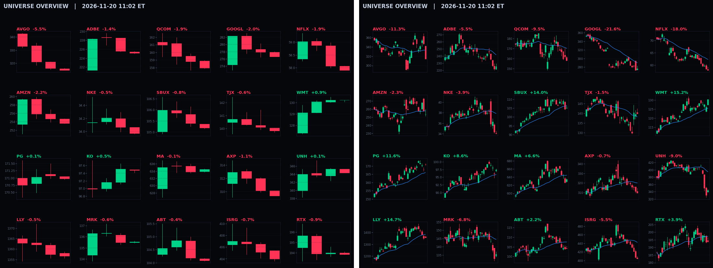

# Daily history replay: tick 20261120T160248Z

Model claude, fetch 2026-11-20T16:02:08.647040+00:00 (2026-11-20 11:02 ET), shortlist of 20. Left: the frame the tick prompted from. Right: the daily prompt frame. Columns CLOSE 1D% 5D% 30D% 30D_HI 30D_LO AVG_VOL.

| Ticker | Intraday frame (as sent) | Daily frame |
|---|---|---|
| AVGO | 314.57 -0.47 +0.00 -5.49 342.90 314.57 3,977,991 | 314.57 -9.25 -9.35 -12.99 369.82 289.77 25,490,863 |
| ADBE | 225.14 -0.19 +0.00 -1.38 229.61 221.27 291,183 | 225.14 +1.56 -7.38 -7.07 272.10 219.80 3,928,356 |
| QCOM | 157.93 -0.55 +0.00 -1.88 162.54 157.64 1,104,244 | 157.93 -2.52 -8.43 -10.01 185.59 148.25 12,492,738 |
| GOOGL | 276.57 -0.46 +0.00 -2.04 283.14 272.83 14,998,091 | 276.57 +1.43 -6.49 -21.35 359.40 272.36 37,338,870 |
| NFLX | 57.90 -0.28 +0.00 -1.89 59.35 57.90 7,836,602 | 57.90 -0.95 -6.83 -17.63 73.07 57.90 41,568,165 |
| AMZN | 253.62 -0.44 +0.00 -2.19 259.97 251.12 11,387,610 | 253.62 -1.46 -4.89 -3.36 275.34 229.36 45,932,479 |
| NKE | 33.97 -0.28 +0.00 -0.50 34.53 33.96 3,480,889 | 33.97 -1.05 -10.58 -2.13 41.10 33.96 24,608,347 |
| SBUX | 105.18 -0.20 +0.00 -0.76 106.60 104.91 495,083 | 105.18 +0.68 -1.18 +15.90 111.50 90.52 8,378,740 |
| TJX | 139.82 -0.19 +0.00 -0.63 142.45 139.57 712,555 | 139.82 +0.29 +4.06 +0.76 148.57 129.39 6,967,197 |
| WMT | 130.22 +0.01 +0.00 +0.88 130.52 127.22 2,704,915 | 130.22 +3.32 +1.66 +16.95 131.82 109.93 21,519,015 |
| PG | 170.97 -0.06 +0.00 +0.13 171.61 170.32 701,468 | 170.97 +1.86 +0.69 +13.05 173.59 149.92 9,859,970 |
| KO | 97.47 -0.04 +0.00 +0.50 97.74 96.76 5,869,608 | 97.47 +1.44 -1.79 +10.70 100.56 87.39 18,207,475 |
| MA | 634.51 +0.11 +0.00 -0.08 637.03 626.68 194,328 | 634.51 +1.28 -4.04 +7.70 681.99 574.00 3,157,249 |
| AXP | 309.39 -0.25 +0.00 -1.13 314.72 309.12 133,850 | 309.39 -0.55 -3.50 +0.40 343.89 302.26 2,837,445 |
| UNH | 344.30 -0.28 +0.00 +0.09 347.39 338.24 1,687,206 | 344.30 +4.18 -15.50 -9.23 426.55 324.67 6,679,378 |
| LLY | 1356.62 -0.06 +0.00 -0.46 1372.05 1354.23 809,003 | 1356.62 +0.41 -6.02 +15.04 1475.25 1151.67 2,859,252 |
| MRK | 135.53 +0.03 +0.00 -0.56 137.17 133.79 1,011,811 | 135.53 +2.05 -8.28 -6.92 154.02 131.36 9,573,550 |
| ABT | 104.08 -0.09 +0.00 -0.44 105.50 104.06 404,978 | 104.08 +0.21 -4.09 +4.50 117.07 97.67 8,800,694 |
| ISRG | 403.99 -0.29 +0.00 -0.74 410.00 403.60 177,576 | 403.99 -0.80 -8.93 -4.71 485.85 398.99 2,444,600 |
| RTX | 193.85 -0.08 +0.00 -0.91 196.78 193.20 219,461 | 193.85 +0.21 -2.38 +4.24 205.62 181.15 5,274,721 |

